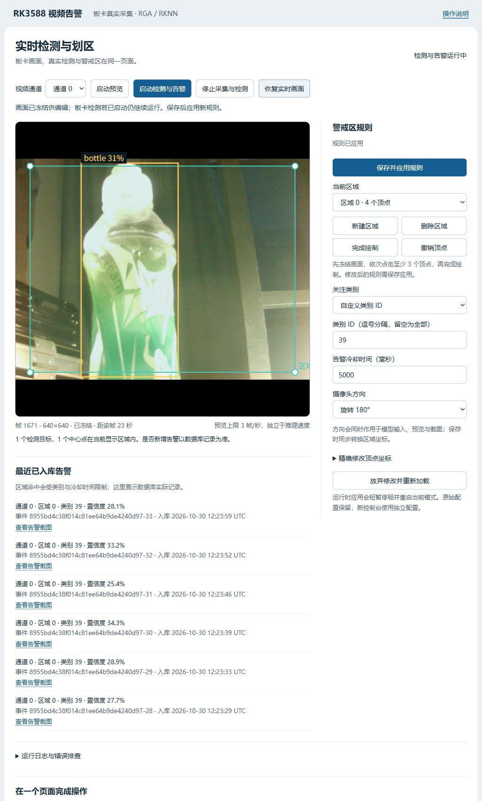
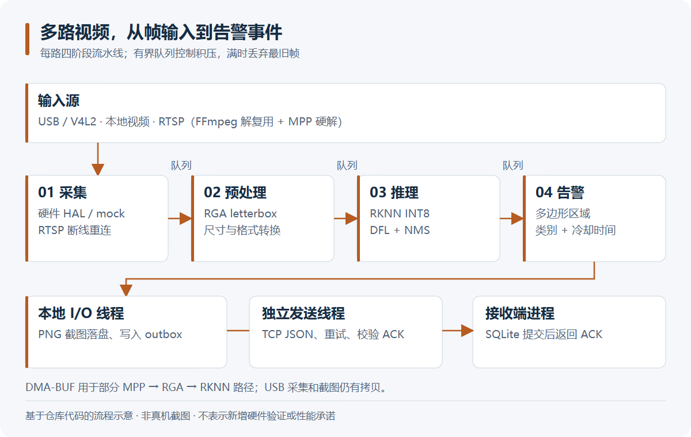
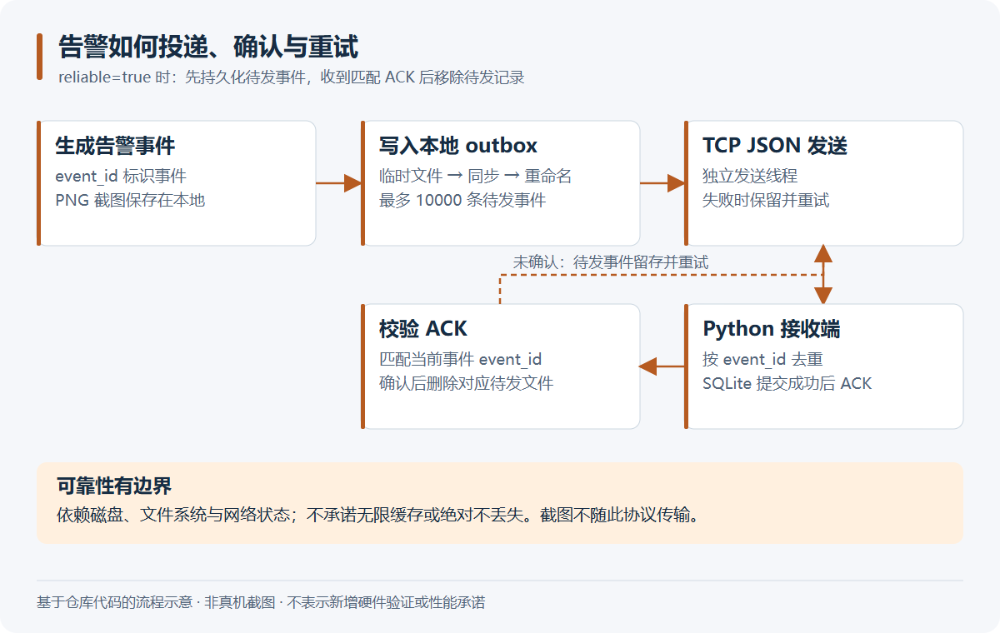

# RK3588 多路边缘目标检测告警系统

## 1. 做什么

在 RK3588 上接入多路视频，完成目标检测和多边形区域告警。C++17 实现采集、预处理、推理、告警四阶段流水线，独立 IO 线程负责截图和事件投递。TCP 只上报事件，视频留在板端。

## 运行画面



现场水瓶对应 COCO 类别 39。网页可以冻结画面拖动警戒区顶点，再保存并应用规则；冻结显示时，板卡仍在检测。操作见[实时控制台](docs/live-console.md)。

调试这次水瓶演示时，程序先报了 `mock class id must be an integer 0..4`。隔离部署还在用旧解析器，把硬件类别也限制成了模拟模式的五类。修正后，硬件允许 0–79，mock 保持 0–4；CTest 8/8 和类别边界专项 10/10 通过，随后产生了新的水瓶告警。[运行记录](docs/board-run-20261030.md)

## 2. 数据流

```text
USB（V4L2）/ 文件、RTSP（FFmpeg 解复用 + MPP 硬解）
  → 采集 → 有界队列 → RGA 预处理
  → 有界队列 → RKNN 推理、DFL 解码、NMS
  → 有界队列 → 多边形区域判断、告警冷却
  → 独立 IO 线程：PNG 截图、持久化 outbox、TCP JSON + ACK
  → Python 接收端：按 event_id 去重，SQLite 提交后返回 ACK
```



每路按阶段分线程运行，队列满时丢最旧帧，避免延迟不断累积。`rknn_dup_context` 共享模型上下文，并发门限限制同时推理的数量。MPP、RGA、RKNN 之间使用 DMA-BUF，USB 采集和截图仍有拷贝。



告警先写本地 outbox；接收端写库成功才发 ACK，未确认的事件保留重试。截图留在本地，TCP 传事件和截图路径。配套的[离线助手](https://github.com/3355-del/rk3588-offline-agent)可读取同一告警库。

源码入口：[流水线](src/pipeline/VideoPipeline.cpp)、[可靠投递](src/hal/DurableAlarmNotifier.cpp)、[接收端](tools/alarm_receiver.py)。`include/` 放接口，`src/hal/` 放硬件与模拟后端，`tests/`、`tools/` 放回归和辅助工具；`module/` 保留构建依赖的练习模块。

## 3. 板卡测试

测试板为 Orange Pi 5，RK3588S，8 GB。

| 项目 | 结果 |
| --- | --- |
| 单路同素材 20 秒分组对照 | CPU 预处理+浮点输出 25.39 FPS → DMA-BUF 输入+直读量化输出 35.05 FPS（+38%） |
| 取帧 / 解码耗时 | 4.9 → 1.33 ms；9.4 → 3.6 ms |
| 双路文件源 | 各约 29.9 FPS |
| 四路文件源 | 合计约 67.4 FPS |
| RTSP 回环 | 约 16.28 FPS |
| 摄像头 + 文件双路 | 连续 3600.7 秒无崩溃，115 条告警入库，两路丢帧 0 / 508 |
| 截图路径 / 回归 | ASan 未报告内存错误（未启用泄漏检测）；历史 CTest 4/4 通过 |
| DMA/CPU 输入与 INT8/float 等价性 | 12 帧，detections=89，PASS |

表中的“取帧”指获取推理输出，“解码”指检测输出后处理。2026-10-30 又补测了 180° 路径：正向和旋转各 12 帧，路径一致性检查通过。[复现方法](docs/detection-quality.md)

## 4. 环境

Orange Pi 5 / Ubuntu 22.04.5 / 内核 6.1.99 / RKNPU 驱动 0.9.8 / RKNN Runtime 2.3.0。MPP 使用自建版本，commit `14729dd578e570e5f00fd1dd2113f5429012d64b`。

硬件构建在板卡上进行，需要 RKNN、RGA、MPP、FFmpeg 开发环境。无硬件构建需要 CMake ≥3.16、C++17 和 Python ≥3.10；Windows 可用 MinGW + Ninja。[依赖说明](docs/dependencies.md)

## 5. 构建与运行

### 先在电脑跑通模拟链路

在仓库根目录执行；Linux 可去掉 `-G Ninja`：

```sh
cmake -S . -B build -G Ninja -DMSAD_ENABLE_RKNN=OFF -DBUILD_TESTING=ON
cmake --build build --parallel 2
ctest --test-dir build --output-on-failure
```

终端一运行接收器，保持窗口开启：

```sh
python tools/alarm_receiver.py --host 127.0.0.1 --port 9000 --db data/alarms.sqlite3
```

终端二运行五秒演示（Windows 使用 `.exe`）：

```sh
./build/multi_stream_alarm_demo config/demo_config.json
```

Windows 如果报临时目录 `Permission denied`，在当前 PowerShell 设置测试临时目录后重跑：

```powershell
New-Item -ItemType Directory -Force build/test-temp | Out-Null
$env:TEMP = (Resolve-Path build/test-temp).Path
$env:TMP = $env:TEMP
ctest --test-dir build --output-on-failure
```

### 在板卡构建硬件版本

先安装外部 SDK，把下面的占位符替换为实际位置。模型放到 `model/model.rknn`，视频源、旋转、类别和区域在配置中设置。

```sh
cmake -S . -B build-board -DMSAD_ENABLE_RKNN=ON -DBUILD_TESTING=ON \
  -DMSAD_RKNN_INCLUDE_DIR=YOUR_RKNN_INCLUDE_DIR \
  -DMSAD_RKNN_LIBRARY=YOUR_LIBRKNNRT_FILE \
  -DMSAD_MPP_ROOT=YOUR_MPP_INSTALL_PREFIX
cmake --build build-board --parallel 2
ctest --test-dir build-board --output-on-failure
./build-board/multi_stream_alarm_demo config/rk3588_config.json
```

### 准备 YOLOv8n INT8 模型

1. 按 [Rockchip 适配导出说明](https://github.com/airockchip/ultralytics_yolov8/blob/main/RKOPT_README.zh-CN.md)获取权重并设置模型路径，在适配仓库执行 `PYTHONPATH=./ python ultralytics/engine/exporter.py` 导出分离检测头 ONNX。
2. 安装与目标 Runtime 兼容的 [RKNN-Toolkit2](https://github.com/airockchip/rknn-toolkit2)，记录版本和提交号。
3. 按 [Model Zoo YOLOv8 指引](https://github.com/airockchip/rknn_model_zoo/tree/main/examples/yolov8)准备实际场景的校准图片清单，修改 `examples/yolov8/python/convert.py` 的 `DATASET_PATH`，执行 `python convert.py YOUR_YOLOV8N.onnx rk3588 i8 YOUR_OUTPUT.rknn`。
4. 使用 RGB、mean=0、std=255；板端输入原始 uint8。核对输入尺寸、三尺度检测头、COCO 80 类和 scale/zp。
5. 将产物放入 `model/`，先跑硬件路径和等价性测试，再做带标注样本评测。

交互操作用[统一实时控制台](docs/live-console.md)。离线划区工具为 `python tools/region_editor.py`；保存后的配置需重新启动检测程序加载。

## 许可

自有代码采用 [MIT](LICENSE)。SDK、模型和转换工具分别遵循原许可。

## 6. 当前边界

- 这只 USB 摄像头采集约 10 FPS，`S_PARM` 调节未生效；上表的高帧率来自文件源。四路数据来自文件，并非四个物理摄像头；RTSP 只验证了本机回环流。
- 使用的是已导出的 INT8 模型，原部署记录为 `agricultureiot/rknn-yolo` 的 YOLOv11n，兼容当前 YOLOv8 风格后处理；上面的 YOLOv8n 转换步骤是复现指引。仓库不含权重、SDK 二进制或原始测试视频。
- 尚无标注数据集评测，现场水瓶仍有漏检和类别波动；截图框约 31%、首次告警约 32.8% 都是单帧置信度，不是准确率。模拟模式验证业务流程，流程图说明模块关系。
- DMA-BUF 覆盖部分硬件路径，内存预算不是进程硬上限；outbox 有容量限制，磁盘故障仍会影响投递。两个项目使用 NPU 时遵守会话锁，双 NPU 会话并行仍未解决。
- 性能记录对应上述板卡、模型和素材，截图与路径一致性测试不替代精度或长稳测试。演示图选用普通物品，原始影像和日志保留在本地。
