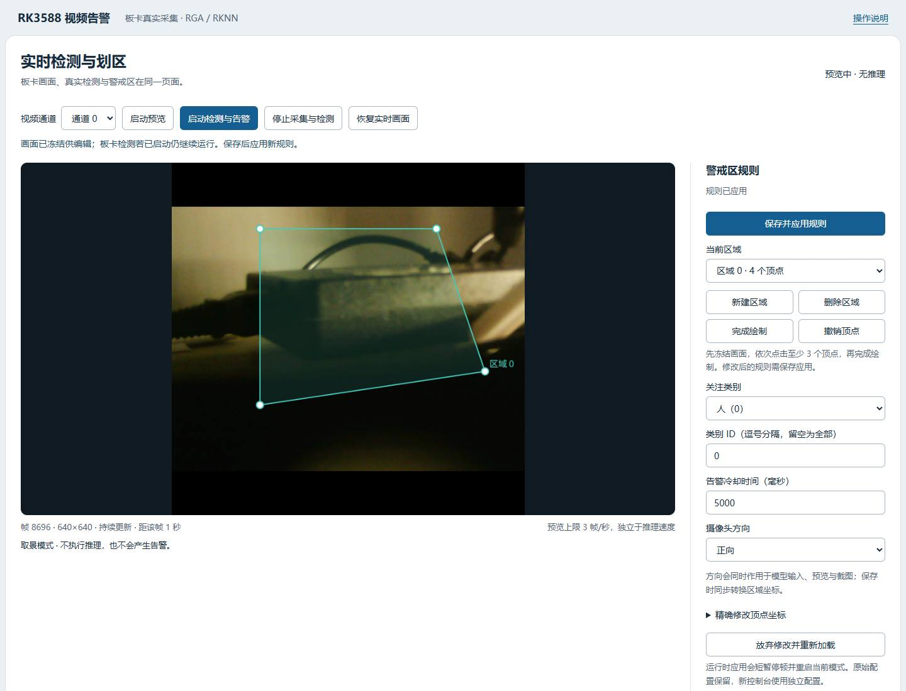

# 统一实时控制台

在同一页完成摄像头取景、划区、保存应用、目标检测与告警查看。打开服务不会开启采集或加载模型，按按钮后才运行。

## 构建与启动

先按README安装依赖并配置、构建、运行CTest。无硬件电脑可用mock验证操作，板卡用真实SDK和模型。

在仓库根目录启动无硬件演示：

```sh
python3 tools/live_console.py --project-root . --config config/demo_config.json --binary build/multi_stream_alarm_live --port 8081
```

Windows使用 `python`，程序路径替换为 `build/multi_stream_alarm_live.exe`。

在板卡真实模式（需要自行准备模型并配置摄像头）使用：

```sh
python3 tools/live_console.py --project-root . --config config/rk3588_config.json --binary build-board/multi_stream_alarm_live --port 8081
```

本机浏览器打开 `http://127.0.0.1:8081/`。如果服务运行在无显示器板卡上，可在电脑另一个终端建立SSH转发：

```sh
ssh -N -L 127.0.0.1:18081:127.0.0.1:8081 YOUR_BOARD_USER@YOUR_BOARD_IP
```

随后电脑浏览器打开 `http://127.0.0.1:18081/`，保持SSH终端运行。板卡仍需独立供电。若板卡镜像已配置ADB，也可使用 `adb forward tcp:18081 tcp:8081`；ADB是否可用取决于板卡镜像、USB服务与电脑驱动。

## 操作顺序

1. 点击“启动预览”，等待首帧。预览走同一采集、预处理链路，不初始化NPU，不推理、不产生告警。
2. 检查方向。若倒置，选择“正向”或“旋转180°”，保存应用。方向同时作用于预处理图像、模型输入、预览及截图；区域坐标同步转换。
3. 点击“冻结画面划区”，拖动现有区域顶点；或新建区域后依次点击至少三个顶点，再点“完成绘制”。支持拖动顶点，暂不支持整块区域平移。
4. 设置关注类别、冷却时间，点击“保存并应用规则”。校验通过后，后台短暂停顿并重启原运行模式，恢复显示。这不是不停机热更新。
5. 点击“启动检测与告警”。画面与框来自同一DetectResult；目标中心在关注区域内时用黄框表示。类别、冷却时间及入库结果共同决定实际新告警。
6. 在“最近已入库告警”按实际事件ID查看截图。冻结网页只暂停显示；关闭网页不会停止后台。结束时点击“停止采集与检测”，再在服务终端按Ctrl+C。

## 配置、可靠性与限制

- 原始配置不覆盖；控制台写入 `data/live-console/config.json`，同时保留最近一份配置备份。首次从旋转180°的硬件配置生成时改为正向并转换原区域，应按实际相机方向核对。
- `data/`、截图、模型、数据库、outbox均不提交仓库。告警使用独立 `alarm_outbox_live/`，仍入项目 `data/alarms.sqlite3`。
- 接收器首启选择回环端口，重启复用outbox记录的目标。端口冲突报错并保留待发事件；不会静默删除或重定向补发队列。
- 预览每路上限3帧/秒，采用有界待处理队列和最近图片缓存，每路最多1280×1280像素。它增加少量内存、编码和传输开销，刷新速度不等于NPU推理FPS。
- 在Linux停止自己启动的进程时先发SIGINT，超过15秒显示错误，不强杀正在写盘的进程。服务默认仅监听回环；控制请求校验会话token和同源，截图只能按事件ID访问指定截图目录。
- 当前公开运行图是2026-10-27真实板卡预览及冻结划区状态，未执行推理。板卡隔离工程已完成编译、CTest 8/8通过；不据此宣称新增mAP、性能或长稳结果。


